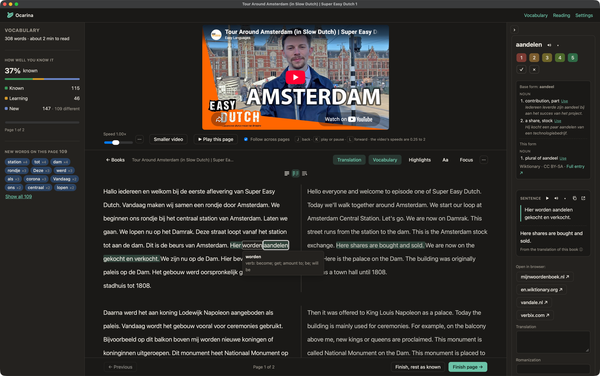
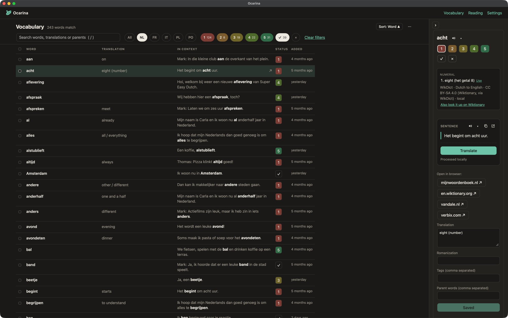

# Ocarina

A Mac app for learning languages by reading. You read texts you choose, click the words you don't know, and Ocarina keeps track of what you have learned. Dictionaries, voices and translation can all run on your Mac, so it works without the internet.

Ocarina is a personal project and a fork of [Lute v3](https://github.com/LuteOrg/lute-v3) (Learning Using Texts), which gave it the reader, the word statuses and the parser. See [Credits](#credits-and-licence).





## What it does

- **Read and learn.** Click a word to see its meaning and give it a status from 1 to 5; mark words as well known or ignored; save phrases. Hover a word for a quick meaning. A focus mode hides everything but the text.
- **Meanings on your Mac.** Small Wiktionary-based dictionaries come with the app (WikDict); fuller ones can be downloaded, and Wiktionary is asked online only when nothing local knows a word.
- **Listen.** Books are read aloud by your Mac's own voice, in any language your Mac has a voice for. An optional, more natural voice runs locally too. Add your own recording and Ocarina syncs it with the text so the sentence being spoken lights up (by its pauses, with no model, or precisely with an optional model; subtitle files work as well).
- **Translate.** Translate a sentence, or a whole text shown side by side with the original. Use a model on your Mac (Qwen3 or TranslateGemma) or an online service (MyMemory, DeepL with your own key). The models page shows how well each model translates each language, measured by Ocarina on 56 languages.
- **Bring your own material.** Files (text, PDF, EPUB), web pages and YouTube videos (captions, or a local transcription when there are none).
- **See your progress.** A bar of the words you learned in Ocarina, reading statistics, a vocabulary page and an overview per language.
- **Your languages.** 66 languages ready to add, each with a sample story; European and Brazilian Portuguese are separate languages.
- **Work offline.** One switch makes Ocarina use only what is on your Mac.

## Install

Needs a Mac with Apple silicon and macOS 14 or later.

1. Download `Ocarina.dmg` from the [latest release](https://github.com/cesartamaral-hub/ocarina/releases/latest) and drag Ocarina to Applications.
2. Ocarina is not signed with an Apple developer account, so the first time, right-click it and choose **Open**. If macOS says the app is damaged, run `xattr -dr com.apple.quarantine /Applications/Ocarina.app` in Terminal.
3. Pick your languages. The first run offers a few optional downloads (a translation model and others); reading works without any of them.

Ocarina checks GitHub for newer versions when it starts and can update itself (Settings → General turns this off).

## Your data and privacy

Your library lives in `~/Library/Application Support/Ocarina` (database, audio, pictures, backups, downloaded models). Nothing leaves your Mac unless you use an online feature: a web dictionary lookup, an online translation service, importing a web page or a video, or downloading a model from Hugging Face. **Work offline** switches all of those off.

## Models

Models are optional downloads, fetched from Hugging Face on your Mac and never bundled. Their licences (MIT, Apache 2.0 and Google's Gemma Terms) and the credits for the dictionaries and libraries are in [NOTICE.md](./NOTICE.md).

## Building from source

```bash
./desktop/dev.sh                 # backend and front end on a copy of your library
source .venv/bin/activate && pytest
cd frontend && npx tsc -b && npm run lint && npm test && npm run build
cd desktop && ./build.sh         # builds desktop/dist/Ocarina.app
```

How the pieces fit is in [docs/ocarina/architecture.md](./docs/ocarina/architecture.md), packaging in [docs/ocarina/packaging.md](./docs/ocarina/packaging.md), and the plan and history in [PLAN.md](./PLAN.md).

## Credits and licence

Ocarina is a hard fork of [Lute v3](https://github.com/LuteOrg/lute-v3) by Jeff Zohrab and contributors (MIT). The Lute manual at [luteorg.github.io/lute-manual](https://luteorg.github.io/lute-manual/) explains the ideas behind the reader, though Ocarina's screens are its own. Dictionary data comes from Wiktionary through Wiktextract and WikDict (CC BY-SA 4.0); the translation test set is FLORES-200 (CC BY-SA 4.0). The code is released under the MIT licence: see [LICENSE.txt](./LICENSE.txt), which must stay with every copy, and [NOTICE.md](./NOTICE.md).
